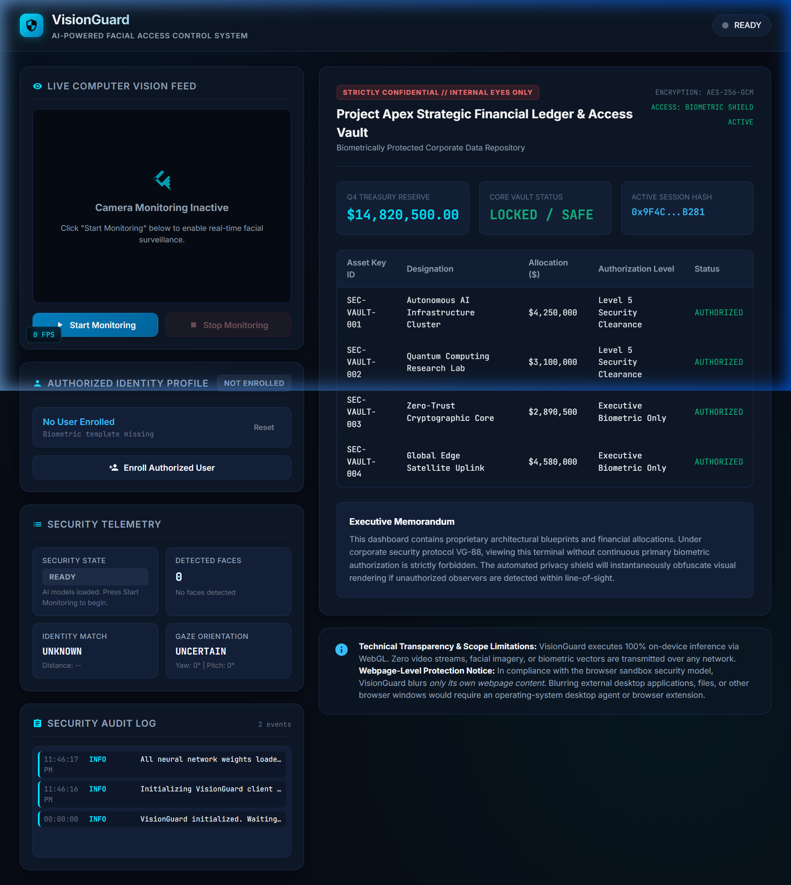

# VisionGuard: AI-Powered Facial Access Control System



> **A real-time, client-side computer vision privacy protection system that monitors workstation screen line-of-sight and automatically deploys a protective privacy shield when unauthorized observers are detected.**

---

## 1. Project Overview & Motivation

In corporate, financial, academic, and public spaces (cafes, libraries, airports, open-plan offices), professionals regularly view confidential documents, source code, financial projections, and credentials on laptop screens. **Shoulder surfing**—the physical act of an unauthorized bystander visually inspecting a user's monitor—represents a critical vulnerability that bypasses all network-level and database encryption.

**VisionGuard** solves this challenge by leveraging a standard laptop webcam and on-device neural networks to monitor visual line-of-sight around the screen. If an unauthorized person is detected looking directly toward the workstation display, VisionGuard automatically blurs the protected webpage content and activates a prominent warning overlay. When the threat departs, safe access is restored following an anti-flicker confirmation cooldown.

---

## 2. Key Features

- **Genuine Real-Time Face Detection**: Powered by an offline, mobile-optimized Tiny Face Detector (depthwise separable CNN) running at ~10 FPS inference with 60 FPS UI rendering.
- **Biometric Facial Recognition**: Implements deep metric learning via a ResNet-34 architecture generating 128-dimensional facial embedding vectors.
- **Local Biometric Enrollment**: Multi-frame vector averaging with L2-normalization stored in extension `chrome.storage.local` (or browser `localStorage` in standalone mode). **Zero raw photographs or video recordings are ever stored or transmitted.**
- **Landmark-Based Gaze & Head Pose Estimation**: Uses 68 2D facial landmarks to calculate Head Pose Yaw, Pitch, and Soukupová-Čech Eye Aspect Ratio (EAR) for honest, documented line-of-sight estimation.
- **Multi-Frame Decision Engine**: Deterministic state machine (`SAFE`, `CAUTION`, `PRIVACY_ALERT`, `NO_USER_DETECTED`, `CAMERA_ERROR`, `MODEL_ERROR`) with 4-frame confirmation and 2.4-second recovery cooldown.
- **Selective CSS Privacy Shield**: Blurs sensitive on-screen content (`filter: blur(22px)`) while maintaining a crisp, unblurred warning banner.
- **Zero-Backend Architecture**: 100% client-side WebGL inference. Works completely offline with zero external cloud API dependencies.

---

## 3. Technology Stack

| Layer | Technologies Used |
|---|---|
| **Frontend Structure** | Semantic HTML5, Vanilla JavaScript (ES2022 Modules) |
| **Styling & Effects** | Modern Vanilla CSS3, Hardware-Accelerated CSS Filters (`backdrop-filter`, `blur`) |
| **AI & Neural Networks** | TensorFlow.js, `@vladmandic/face-api` (v1.7.15) |
| **CV Models (Offline)** | TinyFaceDetector (CNN), ResNet-34 (128-d Metric Learning), 68-Point Landmark Regressor |
| **Hardware Access** | W3C Media Capture API (`navigator.mediaDevices.getUserMedia`) |
| **Local Storage** | Origin-Isolated Browser `localStorage` (Mathematical Vectors Only) |

---

## 4. System Architecture & Data Flow

```
Webcam Stream (640x480) 
   │
   ▼
CameraManager (camera.js) ──► Frame Dispatcher
                                  │
      ┌───────────────────────────┴───────────────────────────┐
      ▼                                                       ▼
FaceDetector (TinyFace CNN)                             FaceRecognizer (ResNet-34)
Bounding Boxes [x, y, w, h]                             128-d Embedding Vectors
      │                                                       │
      ├───────────────────────────┐                           ▼
      │                           ▼                     Identity Matcher
      │                 GazeEstimator (68 Points)       Euclidean Metric (d < 0.52)
      │                 Yaw, Pitch & Eye Aspect Ratio         │
      │                           │                           │
      └───────────────────────────┼───────────────────────────┘
                                  ▼
                    SecurityDecisionEngine (Rules)
                    Multi-Frame Confirmation Hysteresis
                                  │
                                  ▼
                    Privacy Shield UI (app.js)
                    CSS Blur (22px) + Alert Banner
```

---

## 5. Three-Member Team Division of Responsibilities

| Member | Primary Domain | Core Source Files | Primary Viva Topics |
|---|---|---|---|
| **Member 1** | Face Detection & Facial Recognition | `js/face-detection.js`<br>`js/face-recognition.js`<br>`js/enrollment.js` | CNN Detection, ResNet-34 Embeddings, Euclidean Distance, Biometric Privacy |
| **Member 2** | Gaze Estimation & Security Decision Engine | `js/gaze-estimation.js`<br>`js/security-engine.js`<br>`js/config.js` | 68 Facial Landmarks, Head Pose Yaw/Pitch, Eye Aspect Ratio (EAR), Anti-Flicker Hysteresis |
| **Member 3** | Frontend, Privacy Shield & Integration | `index.html`<br>`css/style.css`<br>`js/camera.js`<br>`js/app.js` | WebRTC `getUserMedia`, Canvas 2D HUD Overlays, CSS Selective Blur, Integration |

*For complete contribution checklists and test responsibilities, refer to [docs/member-contributions.md](docs/member-contributions.md).*

---

## 6. Installation & How to Run Locally

### Prerequisites
- A modern web browser with WebGL enabled (Google Chrome, Microsoft Edge, Mozilla Firefox).
- Python 3.x OR Node.js installed to serve static files.

### Step-by-Step Setup Instructions

1. **Clone or Navigate to the Project Directory**:
   ```bash
   cd "vision guard remastered"
   ```

2. **Start a Local HTTP Server**:
   > **Important**: Do not double-click `index.html` directly from your file manager. Browsers block neural network weight manifests over the `file:///` protocol due to CORS security restrictions.
   
   Using Python:
   ```bash
   python -m http.server 8080
   ```
   *OR using Node.js:*
   ```bash
   npx serve -l 8080
   ```

3. **Open VisionGuard in Your Browser**:
   Navigate to:
   ```
   http://localhost:8080
   ```

4. **Enroll the Authorized User**:
   - Click **"Enroll Authorized User"**.
   - Enter your name and click **"Start Capture"**.
   - Look directly at your webcam while the system captures and averages 5 high-quality samples.
   - Once the progress bar reaches 100%, your master template is saved locally.

5. **Start Real-Time Privacy Monitoring**:
   - Click **"Start Monitoring"** and grant camera permission when prompted.
   - When you are alone, the badge displays `SAFE` and the sensitive ledger is clear.
   - Have a colleague step into the frame and look toward the screen: after 4 confirmed frames, the **Privacy Shield** blurs the content and displays an alert overlay.
   - When the bystander looks away or leaves, the shield recovers after a 2.4-second safe confirmation window.

---

## 7. Install and Smoke-Test the Browser Extension

1. **Open the extensions manager**:
   - Chrome: visit `chrome://extensions`.
   - Microsoft Edge: visit `edge://extensions`.
2. Enable **Developer mode** using the switch in the top-right corner.
3. Select **Load unpacked** and choose the project directory containing `manifest.json`.
4. Open `https://en.wikipedia.org` in a normal tab and click the VisionGuard toolbar icon.
5. Select **Enable on This Tab**. Allow camera access if the browser asks. The camera widget appears while the models load; allow a few seconds on first use.
6. Click **Enroll User** in the popup. Keep one face in view, look directly at the camera, and follow the on-page sample progress. Enter a display name when prompted. The popup identity label updates from local extension storage.
7. With the enrolled user still in view, have a second person enter the webcam frame and look toward the screen. After four confirmed inference frames, the privacy shield should blur the page. A person looking away should produce caution but not the full blur.
8. Click **Disable Shield** and verify that the camera indicator turns off and the widget/overlay disappear. Enable and disable once more to verify same-page restart works.

All inference and biometric storage remain on-device. Extension scripts run in Chrome's isolated world, which separates the VisionGuard API context from page JavaScript and allows extension injection without relying on the site's script policy. Camera access still depends on browser/site camera permission, a secure page context, and any site Permissions Policy; check the site settings if capture is denied. VisionGuard prefers WebGL and falls back to TensorFlow.js CPU inference when WebGL is unavailable (at lower speed). It does not add an offscreen camera pipeline: that would add a second document and frame/telemetry messaging path, while direct tab capture remains the lower-latency option.

## 8. Testing & Quality Assurance

VisionGuard includes an automated verification test runner validating all 20 core mathematical, geometric, and security state cases:

```bash
node tests/run-tests.js
```

### Verified Test Summary:
- **Total Test Cases**: 20
- **Passed**: 20 (100%)
- **Failed**: 0 (0%)

*See [tests/test-plan.md](tests/test-plan.md) and [tests/test-cases.md](tests/test-cases.md) for full execution evidence.*

---

## 9. Technical Transparency & Architectural Limitations

1. **Webpage-Level Protection**: In strict compliance with W3C browser security sandboxing, VisionGuard blurs **only its own webpage DOM**. It cannot blur other desktop applications (e.g., Microsoft Word, Excel) or the operating system desktop. System-wide blurring would require a native desktop service (e.g., Electron or C++ daemon).
2. **Documented Gaze Approximation**: Standard laptop webcams lack specialized infrared corneal-reflection hardware. VisionGuard's gaze estimation is an honest geometric approximation combining 3D head pose and Eye Aspect Ratio (EAR), not laboratory eye tracking.
3. **2D Liveness Boundary**: As a standard 2D camera system, physical printed photographs could theoretically match the facial descriptor. Active challenge-response liveness represents future scope.

---

## 10. Comprehensive Documentation & Viva Preparation

Comprehensive academic documentation has been generated in Markdown, Microsoft Word (`.docx`), and Adobe PDF (`.pdf`) formats:

- **Complete Project Guide (Word)**: [`docs/VisionGuard_Complete_Project_Guide.docx`](docs/VisionGuard_Complete_Project_Guide.docx)
- **Complete Project Guide (PDF)**: [`docs/VisionGuard_Complete_Project_Guide.pdf`](docs/VisionGuard_Complete_Project_Guide.pdf)
- **Complete Project Guide (Markdown)**: [`docs/complete-project-guide.md`](docs/complete-project-guide.md)
- **System Architecture**: [`docs/architecture.md`](docs/architecture.md)
- **Member Responsibilities**: [`docs/member-contributions.md`](docs/member-contributions.md)
- **Presentation Script**: [`docs/presentation-script.md`](docs/presentation-script.md)
- **Viva Voce & Cross-Examination Guide**: [`docs/viva-questions.md`](docs/viva-questions.md)
- **Troubleshooting Guide**: [`docs/troubleshooting.md`](docs/troubleshooting.md)
- **Scientific References**: [`docs/references.md`](docs/references.md)

---

## 11. License & Attribution

- Built under the **MIT License**.
- Pretrained neural network weights provided via `@vladmandic/face-api` (MIT License) and original `face-api.js` by Vincent Mühler.
