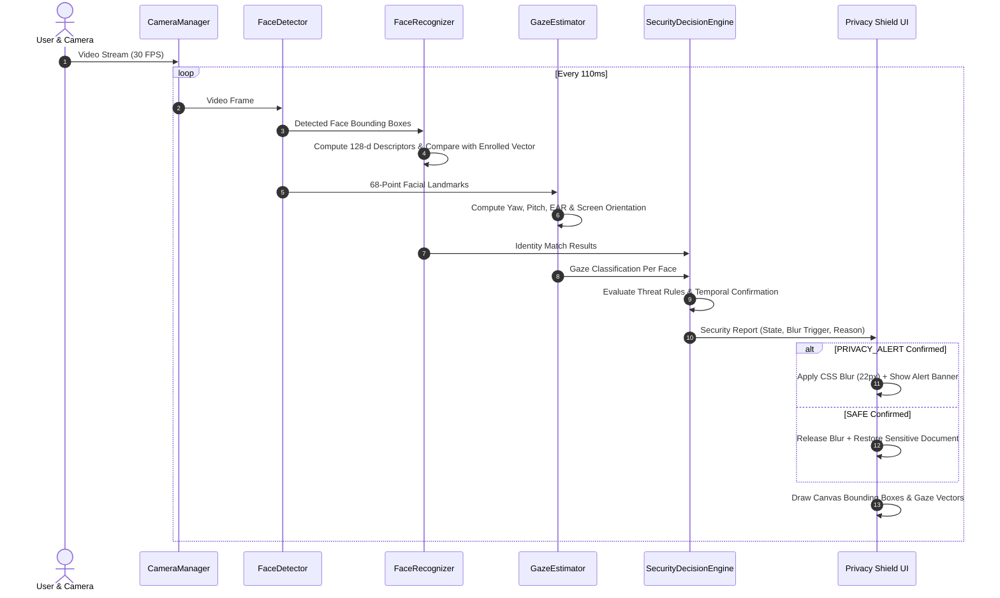

# VisionGuard: System Architecture & Data Flow Specification

## 1. High-Level Architectural Overview

**VisionGuard: AI-Powered Facial Access Control System** is a real-time, zero-backend, client-side computer vision application designed to protect sensitive on-screen content from shoulder surfing and unauthorized visual snooping.

The application executes entirely within the browser sandbox using hardware-accelerated WebGL inference (via TensorFlow.js).

```
                                  +------------------------------------+
                                  |         Webcam Hardware            |
                                  +------------------------------------+
                                                     |
                                                     v (640x480 RGB Video Frames)
                                  +------------------------------------+
                                  |     CameraManager (camera.js)      |
                                  +------------------------------------+
                                                     |
                                                     v
                                  +------------------------------------+
                                  |     FaceDetector (TinyFace/SSD)    |
                                  |      "Where are the faces?"        |
                                  +------------------------------------+
                                                     |
                        +----------------------------+----------------------------+
                        |                                                         |
                        v (Cropped Face Chips)                                    v (Face Landmarks)
      +------------------------------------+                    +------------------------------------+
      |    FaceRecognizer (ResNet-34)      |                    |     GazeEstimator (68 Points)      |
      |        "Who is this face?"         |                    |    "Are they looking at screen?"   |
      +------------------------------------+                    +------------------------------------+
                        |                                                         |
                        v (128-d Descriptors & Match Status)                      v (Gaze State, Yaw, Pitch, EAR)
                        +----------------------------+----------------------------+
                                                     |
                                                     v
                                  +------------------------------------+
                                  |  SecurityDecisionEngine (Rules)    |
                                  |    Multi-Frame Confirmation Hyst.  |
                                  |    SAFE / CAUTION / PRIVACY_ALERT  |
                                  +------------------------------------+
                                                     |
                                                     v
                                  +------------------------------------+
                                  |   Frontend / Privacy Shield UI     |
                                  |   Selective CSS Blur & Overlay     |
                                  +------------------------------------+
```

---

## 2. Component Breakdown & Module Responsibilities

### 2.1 Central Configuration (`js/config.js`)
All operational parameters, Euclidean distance thresholds, head angle cutoffs, temporal confirmation counters, and color tokens are centralized here. The configuration object is deeply frozen (`Object.freeze`) to guarantee immutability.

### 2.2 Camera Lifecycle Subsystem (`js/camera.js` — Member 3)
- Encapsulates `navigator.mediaDevices.getUserMedia`.
- Manages hardware acquisition, resolution querying, and explicit hardware track release (`track.stop()`).
- Translates browser security and hardware exceptions into clear student-friendly diagnostics (`NotAllowedError`, `NotReadableError`, `NotFoundError`).

### 2.3 Face Detection Subsystem (`js/face-detection.js` — Member 1)
- Employs a pre-trained Tiny Face Detector (depthwise separable convolutional neural network) or SSD MobileNet V1.
- Processes incoming frames at ~110ms intervals.
- Generates 2D bounding boxes `[x, y, width, height]` and detection confidence scores.

### 2.4 Facial Recognition & Identity Matching (`js/face-recognition.js` — Member 1)
- Employs a deep metric learning convolutional network (ResNet-34 architecture).
- Maps aligned facial chips into a 128-dimensional Euclidean metric space.
- Compares candidate embeddings with enrolled user vectors using Euclidean distance:
  $$d(\vec{u}, \vec{v}) = \sqrt{\sum_{i=1}^{128} (u_i - v_i)^2}$$
- Thresholds:
  - $d < 0.52$: Highly confident match (`AUTHORIZED`).
  - $0.52 \le d \le 0.64$: Uncertain identity (`UNCERTAIN`).
  - $d > 0.64$: Distinct individual (`UNKNOWN` / Unauthorized viewer).

### 2.5 Authorized Identity Enrollment (`js/enrollment.js` — Member 1)
- Collects 5 high-quality face samples spaced 350ms apart.
- Averages sample descriptors to cancel single-frame sensor noise:
  $$\vec{v}_{\text{master}} = \frac{1}{N} \sum_{k=1}^N \vec{v}_k, \quad \vec{v}_{\text{master}} \leftarrow \frac{\vec{v}_{\text{master}}}{\|\vec{v}_{\text{master}}\|}$$
- Stores **only the 128 mathematical numbers** in `localStorage`. No raw photographs or video recordings are saved.

### 2.6 Gaze & Head Pose Estimation (`js/gaze-estimation.js` — Member 2)
- Evaluates 68 2D facial landmarks without requiring invasive hardware eye-trackers.
- **Head Yaw (Horizontal Turn)**: Computes nose tip offset relative to outer eye corners.
- **Head Pitch (Vertical Tilt)**: Computes nose tip offset relative to mid-eye baseline and chin.
- **Eye Aspect Ratio (EAR)**: Computes palpebral fissure height vs width to detect blinks.
- Explicitly binds gaze measurements to each individual face index.

### 2.7 Security Decision Engine (`js/security-engine.js` — Member 2)
- State Machine States:
  - `SAFE`: Exactly 1 face, matched as authorized user, no unauthorized viewers.
  - `CAUTION`: Face present but gaze uncertain, unauthorized person looking away, or un-enrolled baseline.
  - `PRIVACY_ALERT`: Unauthorized face detected and estimated looking at screen across $\ge 4$ confirmation frames.
  - `NO_USER_DETECTED`: 0 faces detected for $> 2.8$ seconds.
  - `CAMERA_ERROR` / `MODEL_ERROR`: Hardware or runtime failure.
- **Anti-Flicker Recovery**: Requires a sustained 2.4-second window of safe conditions before removing the blur shield.

### 2.8 Privacy Shield Interface (`js/app.js` & `css/style.css` — Member 3)
- Renders bounding boxes, cyber bracket corners, identity labels, and gaze direction vectors on an overlay canvas.
- Dynamically toggles `.shield-active` (`filter: blur(22px)`) on `#protected-content`.
- Displays `#privacy-alert-overlay` in crisp, unblurred rendering with threat count and timestamps.

---

## 3. Data Flow Diagram



---

## 4. Webpage-Level Sandbox Scope Notice

In accordance with modern browser security architecture (W3C Same-Origin Policy & OS sandboxing), JavaScript running in a web tab has access **only to its own DOM tree**. VisionGuard cannot directly alter the display pixels of other browser tabs, desktop applications (Word, Excel, Slack), or the host operating system desktop. 

For full operating-system desktop protection, an OS-level daemon (e.g., Electron with native OS window manager hooks or a C++/Python background service) would be required. VisionGuard demonstrates high-fidelity privacy protection within web-based enterprise applications.
